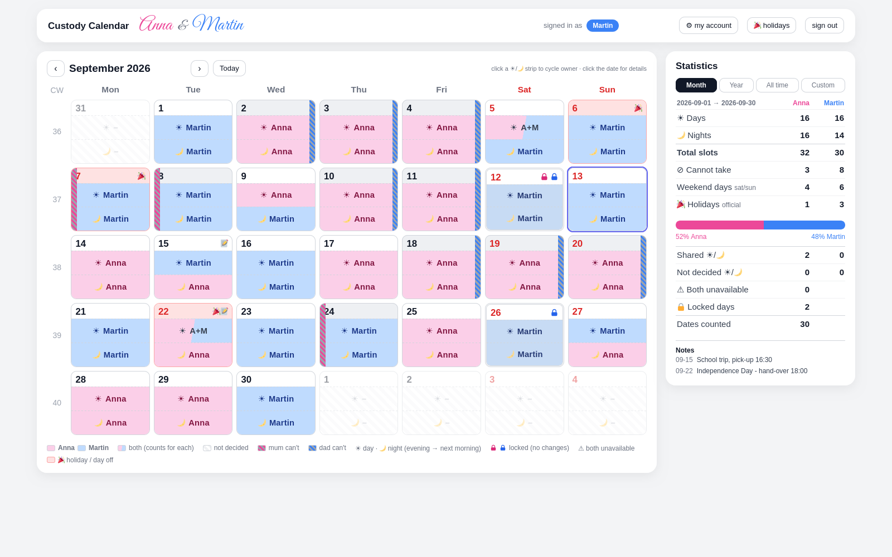
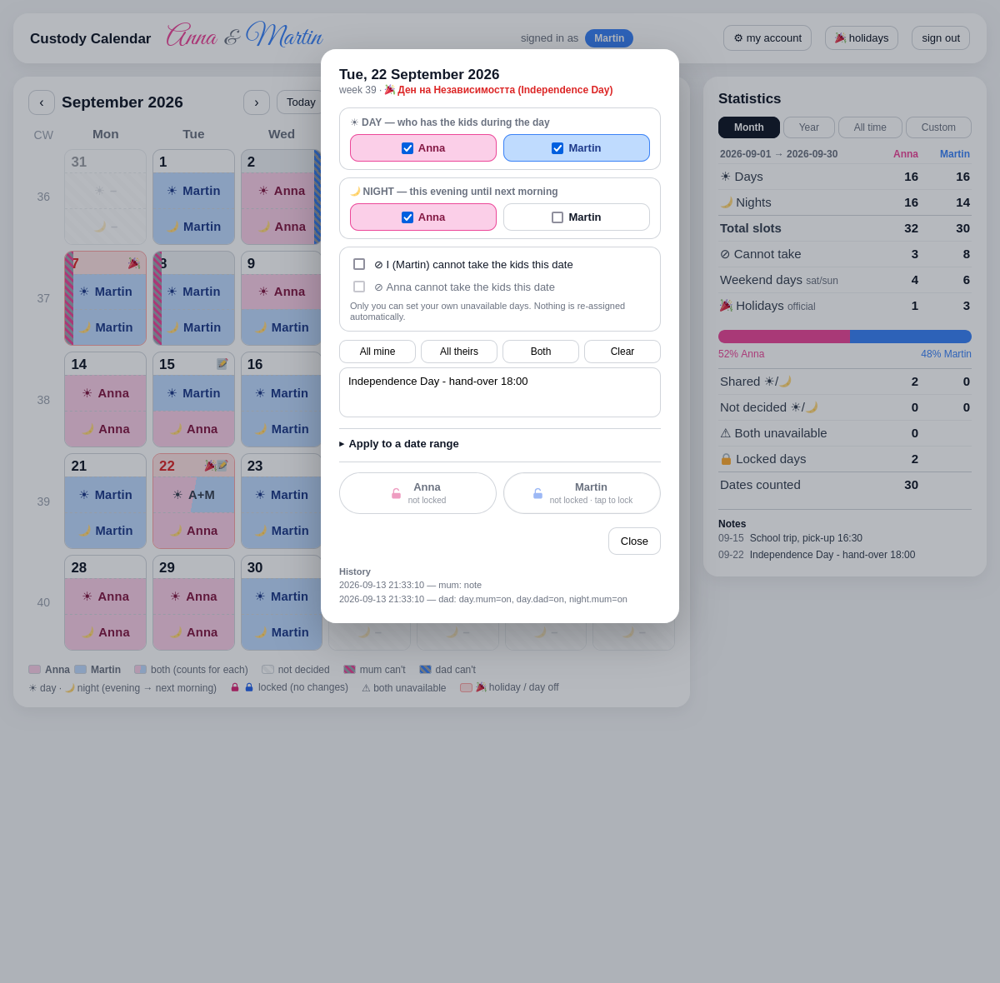

# Custody Calendar

A shared 50/50 custody planner for two parents. **One HTML file, one Python file, plain JSON** —
no frameworks, no database, no build step, nothing to install beyond Python itself.

Both parents sign in from their own devices and edit one calendar: who has the kids each **day**
and each **night**, plus the dates each parent **cannot** take them. The statistics panel shows how
the split actually balances out, and official holidays are marked automatically.

Built in the spirit of [task-tree-planner](https://github.com/ilia92/task-tree-planner).



## Why

After a separation the schedule usually lives in chat messages and memory. Nobody can see the whole
month at once, nobody can prove who has had the kids more, and every shift change turns into a
negotiation from scratch. This puts it on one page both parents can edit.

## Features

- **Day and night are separate.** The kids can be with one parent through the day and the other
  overnight. A night belongs to the evening of its date (the 13th's night = 13th evening → 14th morning).
- **Shared slots count for both.** Tick both parents on one slot when you are both there.
- **NO-days.** Each parent marks the dates they cannot take the kids. It only *suggests* — nothing is
  ever re-assigned behind your back — and a date neither of you can cover is flagged in red.
- **Locking.** One padlock freezes a day completely; only the parent who set it can remove it.
- **Statistics.** Days, nights, weekends, holidays and a balance bar per parent, for the month, the
  year, all time or a custom range.
- **Official holidays**, computed offline (Bulgarian Labour Code art. 154 by default, including
  Orthodox Easter and the weekend-compensation rule), optionally cross-checked online.
- **Live sync.** Each browser polls for the other parent's edits; no reload needed.
- **Per-parent permissions**, enforced on the server rather than hidden in the interface.
- Works offline, on a LAN, or behind a VPN. The font is vendored; no CDN, no tracking, no accounts
  anywhere but your own machine.

## Quick start

```bash
git clone https://github.com/ilia92/custody-calendar
cd custody-calendar
cp config.json.example config.json
python3 server.py --set-user mum      # display name, username, password
python3 server.py --set-user dad
python3 server.py
```

Open <http://localhost:8880>. The server listens on `0.0.0.0`, so the other parent can reach it from
any device on the same network.

Requirements: **Python 3.8+** and a modern browser. No pip install, no dependencies.

## Configuration — `config.json`

```json
{
  "instance_name": "Custody Calendar",
  "port": 8880,
  "country": "BG",
  "poll_seconds": 10,
  "display_order": ["mum", "dad"],
  "backup_dir": "../backup_custody_calendar",
  "parents": {
    "mum": { "username": "mum", "display_name": "Anna",   "password": "changeme", "color": "#ec4899" },
    "dad": { "username": "dad", "display_name": "Martin", "password": "changeme", "color": "#3b82f6" }
  }
}
```

| Key | Meaning |
|---|---|
| `instance_name` | Title in the tab and the top bar |
| `port` | Listening port (a CLI argument wins: `python3 server.py 9000`) |
| `country` | Holiday country code, used when refreshing from date.nager.at |
| `poll_seconds` | How often each browser checks for the other parent's changes |
| `display_order` | Who is shown first everywhere: `["mum","dad"]` or `["dad","mum"]` |
| `parents.*.username` | Login name, always lower-case |
| `parents.*.display_name` | Shown in the script font at the top, in that parent's colour |
| `parents.*.password` | Plain password. `password_hash` (SHA-256) is preferred |
| `parents.*.color` | Pink for mum, blue for dad by default |
| `backup_dir` | Where `backup_calendar.sh` writes snapshots |
| `backup_keep` | How many snapshots to retain (oldest pruned beyond this) |

`display_order` flips the header, the ☀/🌙 tick rows, the padlocks, the statistics columns and the
balance bar. The underlying roles stay `mum` and `dad`; only the display changes.

`config.json` is gitignored. Keep it that way — it holds your passwords.

## Accounts — there are always exactly two

You do not *create* users. The calendar is about two parents, so there are two fixed accounts,
`mum` and `dad`. Filling one in is all "creating a user" means. Three ways:

**1. From the page.** Click **⚙ my account**. Each parent can change their own display name,
username and password, confirming with their current password. Passwords set here are stored as a
SHA-256 hash and the plaintext is removed from `config.json`. You are not signed out by changing it.

**2. From the command line:**

```bash
python3 server.py --set-user mum      # asks for display name, username, password
python3 server.py --list-users        # shows both accounts and how each password is stored
python3 server.py --hash-password     # prints a hash to paste into config.json by hand
```

**3. By editing `config.json`** directly. Changes to names, usernames and passwords are picked up
without a restart; `port`, `instance_name` and `country` need one.

Either parent may only ever change **their own** account, in the page and in the API.

## Using it



**Fast entry:** click the ☀ or 🌙 strip inside a day. Each click cycles
**you → the other parent → both → nobody**. Day and night are independent.

**Full control:** click the date number to open the day popup, where you can

- tick ☀ day and 🌙 night for either parent (tick both — a shared slot counts for each),
- set **your own** ⊘ "I can't take the kids this date",
- leave a note (hand-over time, school trip, doctor),
- lock the day,
- **Apply to a date range** — copy the ticks onto every Monday, a whole shift block, or any
  from/to range with a weekday filter.

Every day has its own link (`…/#2026-09-22`), so you can send the other parent a link that opens
exactly that day.

### What the colours mean

| Look | Meaning |
|---|---|
| Pink strip | Mum has the kids |
| Blue strip | Dad has the kids |
| Split pink/blue | Both — counted for each |
| Hatched white | Nobody decided yet |
| Pink-and-grey stripe on the **left** edge | Mum cannot take the kids that date |
| Blue-and-grey stripe on the **right** edge | Dad cannot take the kids that date |
| Red ring + ⚠ | **Neither** of you can — needs solving |
| Red date number | Saturday, Sunday — or a holiday, which also tints the cell |
| Red cell + 🎉 | Holiday, a day off |
| Pink / blue padlock | Locked by that parent — the whole day is frozen |
| Indigo ring | Today |

### Who may change what

| | Mum | Dad |
|---|---|---|
| ☀ day / 🌙 night for **either** parent | yes | yes |
| ⊘ own unavailability | yes | — |
| ⊘ the other parent's unavailability | no | no |
| 🔒 set / remove own padlock | yes | — |
| 🔒 remove the other parent's padlock | no | no |
| own name / username / password | yes | — |
| the other parent's account | no | no |

### Locking

**One padlock is enough to freeze a day.** As soon as either parent locks a date, nothing on it can
change — not the day, not the night, not a NO-day, not the note — for *either* of you, including the
person who locked it.

Only the parent who set a padlock can remove it. You can always add your own on top, and then the
day stays frozen until both are removed. The popup shows both padlocks side by side, pink and blue,
so you can see who has locked; "Apply to a date range" skips locked days and says which.

### Statistics

Days and nights per parent, total slots, unavailable days, weekend days, holiday days, shared and
undecided slots, conflicts, locked days, and a balance bar with each parent's share.
Scope: **Month / Year / All time / Custom range**.

Shared slots count for *both* parents, so the two columns can add up to more than the number of
dates. "All time" only counts dates that exist in the database.

## Holidays

Bulgarian official non-working days (Labour Code art. 154) are computed offline, including Orthodox
Easter and the rule that a holiday falling on a weekend moves to the next working day. 1 November is
included as a school holiday. All of them are painted red — they are days off.

```bash
python3 server.py --check-holidays 2026     # print the computed table
python3 server.py --refresh-holidays 2026   # cross-check against date.nager.at
```

The 🎉 button in the top bar refreshes the three years around the one you are viewing. Results are
cached in `holidays.json`; entries you edit there by hand and mark `"source": "manual"` survive
refreshes. For another country, set `country` and use the refresh — or replace `bg_holidays()` in
`server.py` with your own rules.

## Making the calendar bigger or smaller

The whole grid — cell height, date numbers, ☀/🌙 icons, names, week numbers, padlocks and the
unavailability ribbons — is driven by one number near the top of `custody_calendar.html`:

```css
#cal-panel { --cs: 1.4; }   /* calendar scale */
```

Raise it for bigger cells, lower it for a denser grid. Every calendar size is a multiple of it.

## Files

```
custody_calendar.html   the whole interface
server.py               HTTP server, API, auth, holiday calculation
config.json             your settings and accounts (gitignored)
data.json               the database (gitignored)
holidays.json           holiday cache (gitignored)
fonts/                  the script font, vendored so it works offline
example/                screenshots
backup_calendar.sh      hourly snapshot helper
```

### The database

`data.json` holds one entry per date that differs from empty:

```json
"2026-09-14": {
  "day":   { "mum": true,  "dad": false },
  "night": { "mum": false, "dad": true  },
  "off":   { "mum": false, "dad": true  },
  "lock":  { "mum": false, "dad": false },
  "note": "handover 18:00",
  "rev": 42,
  "log": [ { "ts": "2026-09-13T10:04:11", "by": "dad", "role": "dad", "what": "night.dad=on" } ]
}
```

Writes are atomic (temp file + rename) and serialised behind a lock, so both parents can edit at the
same time without corrupting the file. Each day keeps its last 10 changes, shown as "History" in the
popup.

### HTTP API

| Method | Route | Purpose |
|---|---|---|
| GET | `/login`, POST `/do-login` | session cookie, 7 days, HttpOnly |
| GET | `/api/state` | everything the page needs: days, settings, parents, holidays |
| GET | `/api/rev` | tiny revision counter, polled for live updates |
| POST | `/api/day` | change one date (`base_rev` guards against stale writes) |
| POST | `/api/range` | apply one change set to a date range + weekday filter |
| POST | `/api/lock` | set or remove your own padlock |
| POST | `/api/account` | change your own name, username or password |
| GET | `/api/holidays?year=&refresh=1` | computed or refreshed holiday list |

## Backups

```bash
chmod +x backup_calendar.sh
crontab -e
0 * * * * /path/to/custody-calendar/backup_calendar.sh >> /path/to/custody-calendar/backup_calendar.log 2>&1
```

Every hour it writes a timestamped copy of `data.json` to
`<backup_dir>/<year>/<month>/<timestamp>.json`, but **only when the file actually changed**, so a
quiet week costs nothing. It refuses to archive a `data.json` that does not parse as JSON, so a
corrupt file can never become your newest "good" snapshot, and it never overwrites an existing
snapshot. `backup_keep` (default 1000) caps how many are retained; the oldest are pruned beyond that.

Restoring is a copy: stop the server, `cp` the snapshot over `data.json`, start it again.

## Run it as a service

```ini
# /etc/systemd/system/custody-calendar.service
[Unit]
Description=Custody Calendar
After=network.target

[Service]
ExecStart=/usr/bin/python3 /path/to/custody-calendar/server.py
WorkingDirectory=/path/to/custody-calendar
Restart=always
User=youruser

[Install]
WantedBy=multi-user.target
```

```bash
sudo systemctl enable --now custody-calendar
```

## Security


Sessions are HttpOnly cookies scoped to the instance and port, valid 7 days, kept in memory —
restarting the server signs everyone out. Passwords are compared with `secrets.compare_digest` and
can be stored as SHA-256 hashes. Failed logins are logged with the IP. The login page deliberately
shows no names, since it is the one page reachable without signing in.

**There is no HTTPS.** Over plain HTTP, passwords and the whole calendar travel unencrypted. Keep it
on your LAN, behind a VPN, or put a reverse proxy with a certificate in front of it before exposing
it to the internet.

## License

MIT — see [LICENSE](LICENSE).

The bundled script font is [Great Vibes](https://fonts.google.com/specimen/Great+Vibes) by the
Great Vibes Pro Project Authors, under the SIL Open Font License 1.1 — see
[fonts/OFL.txt](fonts/OFL.txt). Holiday cross-checks use [date.nager.at](https://date.nager.at);
everything else is self-contained.
